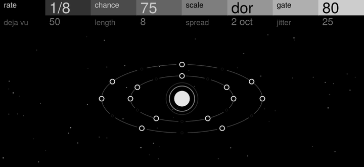
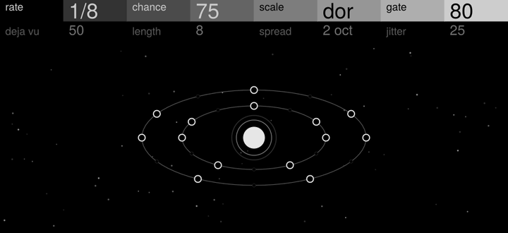
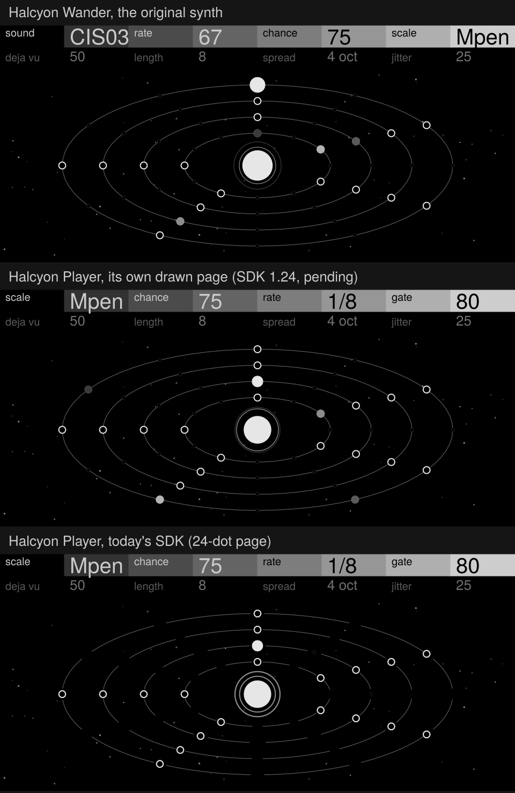

# Halcyon Player

A generative note player for the Teenage Engineering OP–XY, built with the
unofficial [Open-XY SDK](https://github.com/etcetc000/open-xy). Hold a key and
the track's own instrument wanders in a scale of its own, from the key you hold.
After Mutable Instruments' Marbles.

Halcyon Player is [Halcyon Wander](https://github.com/colorsinspace1/halcyon-wander)
by Colors In Space with the synth taken out: the same line (Rate, Chance,
Deja vu, Length, Spread, Jitter, the same eight scales), now sent as notes to
whatever instrument the track plays, stock or SDK. On the OP–XY it is called
**halcyon**.

## See it

On today's SDK (the `main` branch), the page is built from the player page's 24 dots:

[](media/dot-page.mp4)

With its own drawn page (the `drawn-page` branch, which needs SDK 1.22, still a
[pull request](https://github.com/etcetc000/open-xy/pull/578)), the marble glides
to each note, trails its last moves and the halo swells, as in Halcyon Wander:

[](media/drawn-page.mp4)

Tap either for the video with sound. Next to the original:



[Gate, heard](media/gate.mp4): the same line four times, at 10 %, 50 %, 100 % and tie.

These are drawn from the player's own code on a computer, not filmed on an OP–XY,
and the sound is a plain test tone standing in for the track's instrument.

## Controls

| Page 1 | |
| --- | --- |
| **Chance** | how many of those steps sound, 0 to 100 % |
| **Scale** | minor, dorian, harmonic minor, phrygian, lydian, major, major pentatonic, minor pentatonic |
| **Rate** | how often the line steps. Clock on sync: on the project tempo, 2/1 down to 1/32, with triplets. Clock on free: Halcyon Wander's own Rate, from a step every 4 s to 16 a second |
| **Gate** | how long each note holds, 10 to 100 % of a step, or **tie**: until the next note sounds |

| Page 2 (press) | |
| --- | --- |
| **Deja vu** | as on Marbles: 0 always new notes, full loops the last Length steps |
| **Length** | the looped phrase, 1 to 16 steps |
| **Spread** | how far it roams above the key: 1 to 4 octaves |
| **Jitter** | loosens the timing: each step lands up to a quarter step early or late |

| Shift | |
| --- | --- |
| **Hold** (encoder 1) | off or on. On: lines keep playing after you let go; the next key you press after letting go of everything replaces them, and turning Hold off stops what no finger holds. The page shows "hold" while it is on |
| **Clock** (encoder 2) | sync or free. Sync: Rate in note lengths on the project tempo. Free: Rate exactly as Halcyon Wander's, in seconds whatever the tempo, its value shown in seconds ("4.0s", "0.25s", "63ms") |

While you hold Shift the line under the orrery shows this row's settings, for
example "hold off / clock sync".

The first note is always the key you hold, at the velocity you played it; the
notes after it are up to a quarter quieter. Every press starts a new line. Hold
a chord and each key wanders on a line of its own (up to eight keys). Let go
and its line stops, unless Hold is on; the instrument's release carries the
last note.

Sequenced notes play it too: a long step (or a held note in a pattern) is a
held key, so give the sequenced notes the length you want the line to run.

The page is Halcyon Wander's orrery, with its geometry, greys and star field:
the key you hold is the sun, each ring an octave of Spread, the scale's notes
lit at their clock positions, and a marble landing on each note as it sounds,
on its octave's ring. The sun grows while a line plays, its halo swells as each
note sounds, and the marble stays a second after the last key is let go. With
a chord held, the orrery follows the first key.

A note player can't draw its own screen as a synth does: the SDK's player page
shows or hides 24 fixed shapes. `tools/make_panel.py` builds the orrery from
those (scale, Spread, the marble's 48 places, sun and halo); what it can't
carry is motion. So against Halcyon Wander the marble jumps to each note
instead of gliding there, it leaves no trail, and the halo swells for a tenth
of a second instead of easing back. The faint unlit places hide while the
marble shows, so that it stays solid.

## What changed from Halcyon Wander

- **Sound** is gone: the track's instrument makes the sound. The fifteen Halcyon
  sounds stay in [Halcyon Wander](https://github.com/colorsinspace1/halcyon-wander).
- **Gate** is new: a synth decided how long its notes rang, a player has to say.
- **Rate** follows the project tempo in note lengths, unless **Clock** is on
  free (Shift + encoder 2), which runs Halcyon Wander's own Rate in seconds.
  Rate is on encoder 3, the one knob a player's first page turns smoothly, as
  Halcyon Wander's did; Chance, Scale and Gate are lists that step one choice per
  detent, because a player's first page otherwise edits encoder 2 in four steps
  and encoder 4 as off/on.
- The line stops when the key is let go, unless **Hold** is on (new). Hold and
  Clock are on the player's Shift row, which the SDK doesn't save with the
  project, so they are off and sync when a project loads. With eight keys latched, the first key of the next
  chord is silent (stock holds eight roots until the old ones are stopped); the
  chord's other keys play.
- The screen: see above.

## Develop

Keep the [Open-XY SDK](https://github.com/etcetc000/open-xy) on `staging` beside
this repository as `../open-xy`, then:

```
python ../open-xy/sdk.py test --machine .
```

That checks the definition and artwork and runs `tests/player_test.cpp`, a host
model of stock's chord records around the player (first note, Chance, Deja vu
loops, Gate and tie, Jitter's window, chords, a ninth key, long silences,
release and reset, Hold, and the page's dots, decoded back into the marble's
place). `python tools/make_panel.py` rewrites the
artwork; `tools/shot.cpp` and `tools/screens.py` draw the page for review.

Not yet checked on an OP–XY. The SDK reads stock's player step (240 per
quarter note) from stock's code without timing it on a device, so Rate and
Gate rest on that, and the SDK has not yet confirmed on a device that Shift +
encoder turns reach a player, which Hold needs.

## Licence

MIT, see [LICENSE](LICENSE). The line and its scales are Colors In Space's,
from Halcyon Wander; the player's timing follows the approach of
[Euclidean Arp](https://github.com/yfukami/op-xy-euclidean-arp) (MIT).
